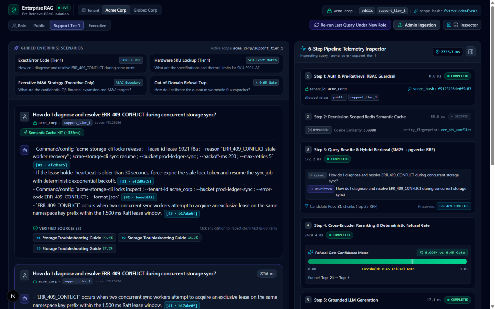
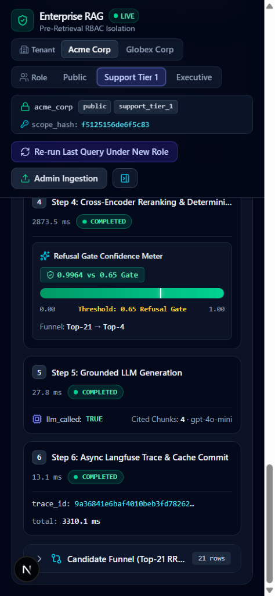
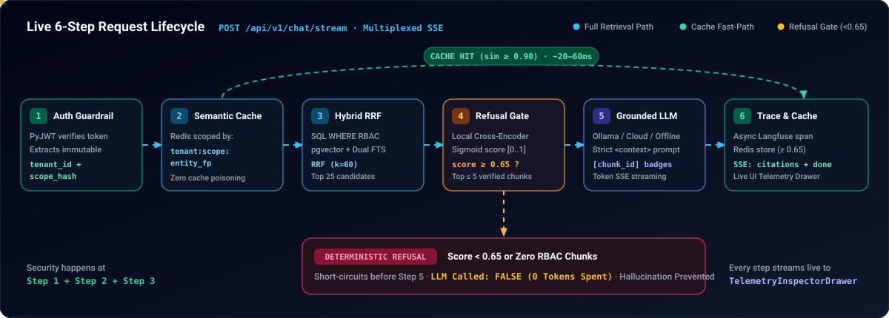
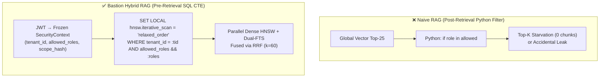

<div align="center">

<a href="https://github.com/shatwiks/Bastion-hybrid-rag">
  
</a>

<br/>

[](backend/pyproject.toml)
[](backend/app/main.py)
[](frontend/package.json)
[](backend/app/retrievers/postgres_hybrid.py)
[](backend/app/services/semantic_cache.py)
[](backend/app/services/llm_provider.py)

<p align="center">
  <strong>Zero-leak multi-tenant Hybrid RAG that stops unauthorized data access and AI hallucinations — with every step visible live in the UI.</strong>
</p>

<p align="center">
  <a href="#-in-10-seconds-for-recruiters--non-technical-readers">10-Second Overview</a> ·
  <a href="#-live-ui-showcase">Live UI</a> ·
  <a href="#-how-a-question-travels-6-step-lifecycle">6-Step Lifecycle</a> ·
  <a href="#-measured-benchmarks">Benchmarks</a> ·
  <a href="#-engineering-deep-dive-for-technical-reviewers">Technical Deep-Dive</a> ·
  <a href="#-quickstart-zero-api-keys-required">Quickstart</a> ·
  <a href="#-core-api-endpoints">API</a> ·
  <a href="#-phase-by-phase-engineering-docs">Docs</a>
</p>

</div>

---

## 🎯 In 10 Seconds (For Recruiters & Non-Technical Readers)

Most company AI chatbots fail in the real world for four predictable reasons: they **leak confidential files** to the wrong employee, **miss exact product/error codes**, **make up answers** when they don't know, and **cost too much** repeating the same work.

**Bastion Hybrid RAG** fixes all four at the architecture level — and lets anyone **watch the AI's security checks, search scores, and citations happen live** on screen:

| Real-World Problem | How Bastion Fixes It (Plain English) | Verified Result |
| :--- | :--- | :--- |
| **Data Leaks Across Teams / Companies** | Checks the user's company (`tenant`) and job role (`Public`, `Support`, `Executive`) **inside the database before searching**, so restricted documents are completely invisible. | **`0.0%` data leaks** across adversarial role & tenant tests |
| **Missed Error Codes & Technical Tables** | Searches by **both meaning and exact keywords** (combining AI embeddings + full-text search) while keeping tables and CLI blocks intact. | **`100.0%` precision** & **`+32.59%` MRR lift** over standard vector RAG |
| **AI Hallucinations (Making Things Up)** | Scores retrieved evidence with a dedicated verifier model. If confidence is below **`0.65`**, the system **refuses immediately without even calling the LLM**. | **`100%` trap refusal** (**`0` LLM tokens spent**) |
| **Slow / Expensive Repeat Questions** | Remembers verified answers in a **permission-locked Redis cache** so repeated questions return in **~20–60ms** without leaking across roles. | **Instant cached replies** scoped strictly per company + role |

> **Works offline out of the box:** No OpenAI/Gemini/Anthropic API key is required to run, test, or demo the full system — local HuggingFace models power embeddings and reranking, and generation runs in deterministic offline mode (or plugs directly into local **Ollama** or cloud LLMs via `.env`).

---

## 🖥️ Live UI Showcase

Instead of a black-box chatbot, Bastion ships with a **glass-box Next.js workspace**: switch tenants and roles in one click, inspect exact source chunks behind every citation badge, watch all 6 pipeline steps update live over SSE, and upload new Markdown documents with role-based access rules.

<div align="center">
  
  <br/>
  <em>Desktop Split-Pane Workspace: Live Tenant/Role Persona Bar, Guided Enterprise Scenarios, Clickable <code>[#1 · chunk_id]</code> Citations, and the 6-Step Telemetry Inspector with the <code>0.65</code> Refusal Gate meter.</em>
</div>

<br/>

<table>
  <tr>
    <td width="64%" valign="top">
      <h3>What You Can Test Live in 60 Seconds</h3>
      <ol>
        <li><strong>One-Click Persona &amp; Tenant Switching:</strong> Flip between <code>Acme Corp</code> / <code>Globex Corp</code> and <code>Public</code> / <code>Support Tier 1</code> / <code>Executive</code> — mints a real signed JWT and updates <code>scope_hash</code> immediately.</li>
        <li><strong>Clickable Grounded Citations:</strong> Ask about <code>ERR_409_CONFLICT</code> or <code>SKU-9921-A</code>, then click any inline <code>[#1 · ef2d9ac5]</code> badge to view the source document, header breadcrumb, allowed roles, Dense/BM25 ranks, RRF score, and Cross-Encoder percentage.</li>
        <li><strong>Live Semantic Cache + RBAC Proof:</strong> Ask the confidential M&amp;A question twice as <code>Executive</code> (2nd run hits Redis cache in ~20–60ms), then switch to <code>Public</code> and click <strong>"Re-run Last Query Under New Role"</strong> → cache misses and refuses with zero leak.</li>
        <li><strong>Deterministic Hallucination Trap:</strong> Click <em>"Out-of-Domain Refusal Trap"</em> → Step 4 short-circuits at <code>&lt; 0.65</code> with <code>LLM Called: FALSE (0 Tokens Spent)</code>.</li>
        <li><strong>Admin Markdown Ingestion + HTTP 403 Guard:</strong> Upload any <code>.md</code> runbook under <code>Support Tier 1</code> / <code>Executive</code> and query it immediately — or try as <code>Public</code> to see live backend <code>403 Forbidden</code> enforcement.</li>
      </ol>
    </td>
    <td width="36%" align="center" valign="top">
      
      <br/>
      <em>Responsive mobile layout (<code>390×844</code>) with zero horizontal overflow.</em>
    </td>
  </tr>
</table>

---

## ⚡ How a Question Travels (6-Step Lifecycle)

Every request to `POST /api/v1/chat/stream` executes a deterministic 6-step pipeline orchestrated by [`RAGPipelineOrchestrator`](backend/app/services/rag_pipeline.py), streaming real-time Server-Sent Events (`step_update`, `token`, `citations`, `refusal`, `done`) to the UI:

<div align="center">
  
</div>

<details>
<summary><strong>Click to inspect each of the 6 stages (Plain English + Code Implementation)</strong></summary>

| Step | Plain-English Role | Engineering Implementation | Source File |
| :---: | :--- | :--- | :--- |
| **1** | **Verify who you are** | Validates signed `HS256` JWT via `PyJWT[crypto]`, extracting a frozen `SecurityContext` (`tenant_id`, `allowed_roles`, 16-char canonical `scope_hash`). | [`security.py`](backend/app/core/security.py) |
| **2** | **Check safe shortcut cache** | Rewrites multi-turn follow-ups (turn-1 fast-path skips rewrite), computes dense embedding, and checks Redis namespace `llm_cache:{tenant_id}:{scope_hash}:{entity_fingerprint}:{entry_id}` (`sim ≥ 0.90`). | [`semantic_cache.py`](backend/app/services/semantic_cache.py) |
| **3** | **Search by meaning + exact words** | Runs parallel `pgvector` HNSW cosine search and dual-dictionary `tsvector` (`simple` + `english`) **inside an RBAC-filtered SQL CTE**, fused with **Reciprocal Rank Fusion (`k=60`)** into top 25 candidates. | [`postgres_hybrid.py`](backend/app/retrievers/postgres_hybrid.py) |
| **4** | **Verify relevance & block guesses** | Local `Sigmoid`-calibrated Cross-Encoder (`cross-encoder/ms-marco-MiniLM-L6-v2`) scores all `(query, chunk)` pairs in a worker thread (`asyncio.to_thread`). If `top_score < 0.65` or empty, **short-circuits with 0 LLM tokens spent**. | [`reranker.py`](backend/app/services/reranker.py), [`refusal_gate.py`](backend/app/services/refusal_gate.py) |
| **5** | **Write cited answer** | Injects top ≤ 5 verified chunks inside `<context>` tags into a strict zero-hallucination prompt via LiteLLM (Offline / Ollama / OpenAI / Gemini / Anthropic), streaming tokens with verified inline `[chunk_id]` tags. | [`grounded_generator.py`](backend/app/services/grounded_generator.py) |
| **6** | **Save cache & telemetry trace** | Persists high-confidence (`≥ 0.65`) answers to Redis, exports async Langfuse trace spans without blocking the stream, and emits `citations` + `done` SSE frames. | [`telemetry.py`](backend/app/services/telemetry.py), [`rag_pipeline.py`](backend/app/services/rag_pipeline.py) |

</details>

---

## 📊 Measured Benchmarks

Evaluated deterministically by [`ComparativeBenchmarkRunner`](backend/app/evals/benchmark_suite.py) against live PostgreSQL + local HuggingFace models and recorded in [`evals/reports/latest_benchmark.json`](evals/reports/latest_benchmark.json) across **28 retrieval probes** (17 multi-tenant golden questions + 11 exact technical jargon probes) and **14 adversarial refusal/RBAC traps**:

<div align="center">
  
</div>

| Metric | Naive Dense-Only Baseline | Bastion Hybrid RAG | CI Quality Gate | Status |
| :--- | :---: | :---: | :--- | :---: |
| **Retrieval Precision** | `0.8143` (81.43%) | **`1.0000` (100.0%)** | `≥ 0.85` (target ~88%) | ✅ PASS |
| **Mean Reciprocal Rank (MRR)** | `0.7542` | **`1.0000` (+32.59% lift)** | `≥ +26.0%` lift | ✅ PASS |
| **Ungrounded Answer Rate (Traps)** | `1.0000` (100% halluc.) | **`0.0000` (100% reduction)** | `≥ 82.0%` reduction | ✅ PASS |
| **Cross-Tenant & RBAC Leakage** | `0.0000` | **`0.0000` (0 / 14 traps)** | Strictly `== 0.0` | ✅ PASS |

> Ragas v0.4 two-cohort evaluation ([`ragas_runner.py`](backend/app/evals/ragas_runner.py)) cleanly separates **Cohort 1 (Answerable In-Scope)** from **Cohort 2 (Adversarial Refusal / RBAC)** with throttled `RunConfig(max_workers=2, max_retries=5, timeout=60)` so deterministic refusals are never misgraded as low-faithfulness hallucinations.

---

## 🔬 Engineering Deep-Dive (For Technical Reviewers)

### 1. Pre-Retrieval SQL RBAC vs. Broken Post-Filtering



- **Protocol-Enforced Security Boundary:** [`_VectorStoreRetrieverMeta`](backend/app/retrievers/base.py) checks at class-definition time that every retriever adapter accepts a `SecurityContext` parameter. Both [`PostgresHybridRetriever`](backend/app/retrievers/postgres_hybrid.py) (primary) and [`QdrantHybridRetriever`](backend/app/retrievers/qdrant_hybrid.py) (secondary adapter) satisfy the exact same contract.
- **No Top-K Starvation:** Enabling `SET LOCAL hnsw.iterative_scan = 'relaxed_order'` on PostgreSQL 17 + `pgvector 0.8+` guarantees `public` users still receive full top-K results even when `executive` chunks dominate nearby vector space.

### 2. Why Exact Error Codes (`ERR_409_CONFLICT`, `SKU-9921-A`) Never Miss
- **Structure-Aware Chunking ([`text_splitter.py`](backend/app/services/text_splitter.py)):** Splits along `#`/`##`/`###` Markdown headers while keeping **pipe tables and fenced CLI code blocks atomic** (never sliced mid-block), prefixing every chunk with its hierarchical breadcrumb (`[Document Title > H1 > H2 > H3]`).
- **Dual-Dictionary Lexical + Delimiter Expansion ([`token_expansion.py`](backend/app/services/token_expansion.py)):** Expands technical identifiers across delimiter variants and indexes chunks with **both** `to_tsvector('simple', ...)` (preserves exact error codes/SKUs verbatim) and `to_tsvector('english', ...)` (handles natural-language stemming).

### 3. Permission- & Entity-Fingerprinted Redis Semantic Cache
```text
llm_cache:{tenant_id}:{scope_hash}:{entity_fingerprint}:{entry_id}
```
- **`tenant_id` + `scope_hash`:** Prevents `executive` answers from ever being served to `public` or another tenant's users.
- **`entity_fingerprint`:** Extracts sorted technical identifiers (e.g., `err_409_conflict`) so semantically similar questions about **`ERR_409_CONFLICT`** and **`ERR_503_SERVICE_UNAVAILABLE`** never collide in cosine vector space.
- **Automatic Invalidation:** Ingesting or updating a tenant document immediately clears that tenant's cache namespace via [`SemanticCacheService.invalidate_tenant`](backend/app/services/semantic_cache.py).

### 4. Non-Blocking Local ML Inference
- Both `BAAI/bge-small-en-v1.5` (384-dim Bi-Encoder) and `cross-encoder/ms-marco-MiniLM-L6-v2` (Sigmoid-calibrated Cross-Encoder) are pre-warmed at FastAPI startup and executed via `await asyncio.to_thread(...)` behind a bounded semaphore so CPU-bound PyTorch passes never block active SSE streams or `/api/v1/health`.

---

## 🧰 Tech Stack & Repository Map

| Layer | Technologies |
| :--- | :--- |
| **Backend API** | Python `3.12+`, Async FastAPI (`0.162.3`), Uvicorn, Pydantic v2, `PyJWT[crypto]` |
| **Vector + Lexical DB** | PostgreSQL 17 (`pgvector/pgvector:pg17`), SQLAlchemy Async + `asyncpg`, Alembic (`HNSW` cosine + `GIN` `allowed_roles` & `tsvector`), pluggable [`QdrantHybridRetriever`](backend/app/retrievers/qdrant_hybrid.py) |
| **Semantic Cache** | Redis 8 (`redis:8-alpine`), `redis.asyncio` / `redisvl` |
| **Local ML Models** | `sentence-transformers` + PyTorch: `BAAI/bge-small-en-v1.5` (embeddings) & `cross-encoder/ms-marco-MiniLM-L6-v2` (Sigmoid reranker) |
| **LLM Providers & Tracing** | LiteLLM supporting **Offline Mode**, local **Ollama** (`ollama_chat/<model>`), OpenAI, Gemini, Anthropic + async Langfuse exporter |
| **Evaluation** | Two-cohort golden + adversarial datasets, Ragas v0.4, deterministic IR benchmark suite |
| **Frontend UI** | Next.js `16.4.6` (App Router, Turbopack), React `19.3.1`, TypeScript, Tailwind CSS `4.3.5`, Lucide React |

<details>
<summary><strong>Click to expand repository structure</strong></summary>

```text
Bastion-hybrid-rag/
├── backend/
│   ├── alembic/                  # PostgreSQL 17 migrations (pgvector HNSW, GIN tsvector & roles)
│   ├── app/
│   │   ├── api/v1/               # auth.py, documents.py, chat.py, health.py
│   │   ├── core/                 # security.py (HS256 JWT & canonical scope_hash)
│   │   ├── db/                   # Async SQLAlchemy engine, Document & DocumentChunk ORM
│   │   ├── evals/                # ragas_runner.py & benchmark_suite.py
│   │   ├── retrievers/           # base.py protocol, postgres_hybrid.py, qdrant_hybrid.py
│   │   ├── schemas/              # Pydantic request/response/SSE/trace contracts
│   │   ├── scripts/              # seed_corpus.py (idempotent multi-tenant loader)
│   │   └── services/             # text_splitter, token_expansion, embeddings, ingestion,
│   │                             # query_rewriter, hybrid_retrieval, reranker, refusal_gate,
│   │                             # semantic_cache, llm_provider, grounded_generator,
│   │                             # telemetry, rag_pipeline
│   └── tests/                    # Unit & integration test suites
├── frontend/
│   └── src/
│       ├── app/                  # Split-pane Next.js chat & inspector workspace
│       ├── components/           # PersonaBar, ChatViewport, CitationPopover,
│       │                         # TelemetryInspectorDrawer, AdminIngestionModal
│       ├── lib/                  # sse-client.ts (Fetch ReadableStream SSE + XSS-safe citations)
│       └── types/                # TypeScript SSE, telemetry, and API interfaces
├── seed/                         # 2 tenants (acme_corp, globex_corp) × 3 roles + refusal traps
├── evals/                        # Golden/adversarial datasets & latest_benchmark.json
├── docs/                         # Phase-by-phase engineering walkthroughs & README visual assets
├── docker-compose.yml            # postgres (5437), redis (6379), backend (8000), frontend (3005)
└── .env.example                  # Default local configuration template
```

</details>

---

## 🚀 Quickstart (Zero API Keys Required)

### 1. Configure Environment
```bash
cp .env.example .env
```

Choose your generation mode in `.env`:
- **Offline Mode (Default — zero setup):** Leave API keys blank. Embeddings and Cross-Encoder reranking run locally, and generation uses deterministic extractive grounding.
- **Local Ollama (Free local LLM):** Run `ollama pull llama3.2` and set:
  ```env
  LLM_MODEL=ollama_chat/llama3.2
  OLLAMA_API_BASE=http://localhost:11434
  ```
  *(Inside Docker Compose, container access automatically defaults to `http://host.docker.internal:11434`.)*
- **Cloud LLMs:** Set `LLM_MODEL` (`gpt-4o-mini`, `gemini/gemini-2.5-flash`, or `claude-3-7-sonnet`) and the matching `OPENAI_API_KEY` / `GEMINI_API_KEY` / `ANTHROPIC_API_KEY`.
- **Optional Langfuse Tracing:** Set `LANGFUSE_PUBLIC_KEY`, `LANGFUSE_SECRET_KEY`, and `LANGFUSE_HOST`.

### 2. Option A — Fast Local Development (Recommended)
Start PostgreSQL (`5437`) and Redis (`6379`):
```bash
docker compose up -d postgres redis
```

**Terminal 1 — Backend (`http://127.0.0.1:8000`):**
```bash
cd backend
uv sync
uv run alembic upgrade head
uv run python -m app.scripts.seed_corpus
uv run uvicorn app.main:app --reload --port 8000
```

**Terminal 2 — Frontend (`http://localhost:3005`):**
```bash
cd frontend
npm install
npx next dev -p 3005
```

### 3. Option B — Full Docker Compose Stack
```bash
docker compose up --build
```
Then run migrations and seed once:
```bash
cd backend && uv run alembic upgrade head && uv run python -m app.scripts.seed_corpus
```

Open:
- **Interactive UI:** `http://localhost:3005`
- **FastAPI Swagger Docs:** `http://localhost:8000/docs`
- **Health Check:** `http://localhost:8000/api/v1/health`

---

## 🔌 Core API Endpoints

| Method & Path | Auth | Description |
| :--- | :--- | :--- |
| `GET /api/v1/health` | Public | Verifies PostgreSQL (`pgvector`) & Redis connectivity |
| `POST /api/v1/auth/demo-token` | Public | Mints signed JWT for `acme_corp` / `globex_corp` across `public`, `support_tier_1`, `executive` |
| `GET /api/v1/auth/me` | Bearer JWT | Returns verified `tenant_id`, `allowed_roles`, and `scope_hash` |
| `POST /api/v1/ingest` | Bearer JWT (`support_tier_1` / `executive` / `admin`) | Structure-aware Markdown chunking, token expansion, embedding, idempotent commit, and tenant cache invalidation |
| `GET /api/v1/documents` | Bearer JWT | Lists indexed documents strictly scoped to caller's `tenant_id` |
| `POST /api/v1/chat/stream` | Bearer JWT | Streams multiplexed 6-step SSE lifecycle (`step_update`, `token`, `citations`, `refusal`, `done`) |
| `GET /api/v1/chat/traces/{trace_id}` | Bearer JWT | Fetches full 6-step telemetry trace (`403 Forbidden` across tenants) |

---

## 🧪 Testing & Verification

```bash
# Backend unit & integration tests + linting
cd backend
uv run pytest tests -v
uv run ruff check app tests

# Frontend type-check & production build
cd frontend
npx tsc --noEmit
npm run build
```

---

## 📚 Phase-by-Phase Engineering Docs

Want to understand every SQL CTE, Redis key format, Cross-Encoder threshold calibration, and React SSE component? Dive into [`docs/README.md`](docs/README.md):

1. [**Phase 1:** Foundation, Pre-Retrieval RBAC & Pluggable Retriever](docs/phase-01-foundation-rbac-retriever.md)
2. [**Phase 2:** Structure-Aware Ingestion, Token Expansion & Seed Corpus](docs/phase-02-ingestion-embeddings-seed.md)
3. [**Phase 3:** Query Rewriting, Hybrid RRF, Cross-Encoder Reranking & Refusal Gate](docs/phase-03-hybrid-rrf-reranking-refusal-gate.md)
4. [**Phase 4:** Permission-Scoped Semantic Cache, Grounded Streaming & Telemetry](docs/phase-04-semantic-cache-grounded-sse-telemetry.md)
5. [**Phase 5:** Ragas Evaluations & Comparative Baseline Benchmark Gates](docs/phase-05-ragas-evals-benchmark-gates.md)
6. [**Phase 6:** Next.js Chat, Live 6-Step Inspector & Admin Ingestion UI](docs/phase-06-nextjs-chat-inspector-admin-ui.md)
