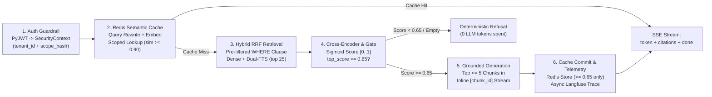

# Enterprise Multi-Tenant RAG Knowledge Engine

A production-grade, multi-tenant **Retrieval-Augmented Generation (RAG)** system built for internal enterprise support and knowledge management. Unlike naive RAG tutorials that embed raw text slices, filter permissions in Python, and allow LLMs to guess when context is weak, this engine enforces mathematical pre-retrieval RBAC isolation, hybrid dense + lexical search, semantic caching, and a deterministic refusal gate.

---

## Core Failure Modes Solved

1. **Cross-Tenant & Privilege-Escalation Data Leaks:**
   - Naive RAG retrieves top-K globally and filters permissions afterward in application code—causing **Top-K starvation** for lower-privilege users or exposing restricted text.
   - Here, signed JWT claims (`tenant_id`, `allowed_roles`) are extracted into an immutable `SecurityContext` (`PyJWT[crypto]`) and injected directly into PostgreSQL `WHERE` clauses (`tenant_id = :tenant_id AND allowed_roles && :user_roles`) **prior to HNSW/FTS ranking**, enforced at the protocol level by `_VectorStoreRetrieverMeta`.
2. **Poor Recall on Technical Jargon (`ERR_*`, `SKU-*`, CLI Flags):**
   - Structure-aware Markdown splitting keeps pipe tables and fenced CLI code blocks whole, injects `[Title > H1 > ...]` breadcrumbs, expands exact technical identifiers across 7 delimiter variants, and pairs `pgvector` dense vectors with dual-dictionary PostgreSQL `tsvector` (`simple` + `english`) via **Reciprocal Rank Fusion (`rrf_k = 60`)**.
3. **Repeated Latency & Cloud LLM Cost:**
   - A Redis semantic cache partitioned by `llm_cache:{tenant_id}:{scope_hash}:{entity_fingerprint}:{entry_id}` returns grounded responses on high cosine similarity (`>= 0.90`) while preventing cross-role leaks and exact error-code collisions (e.g., `ERR_409_CONFLICT` vs `ERR_503_SERVICE_UNAVAILABLE`).
4. **LLM Hallucinations on Uncovered Topics:**
   - A local `Sigmoid`-calibrated Cross-Encoder (`cross-encoder/ms-marco-MiniLM-L6-v2`) deeply rescores top RRF candidates. If `top_rerank_score < 0.65` (`REFUSAL_THRESHOLD`) or zero accessible chunks exist, execution short-circuits before LLM invocation with **0 LLM tokens spent** and a deterministic refusal message.

---

## End-to-End 6-Step Request Lifecycle

Every request to `POST /api/v1/chat/stream` streams real-time Server-Sent Events (`step_update`, `token`, `citations`, `refusal`, `done`) orchestrated by [`RAGPipelineOrchestrator`](backend/app/services/rag_pipeline.py):



---

## Measured Benchmark Results

Evaluated by [`ComparativeBenchmarkRunner`](backend/app/evals/benchmark_suite.py) and recorded in [`evals/reports/latest_benchmark.json`](evals/reports/latest_benchmark.json) across **28 retrieval probes** (17 multi-tenant golden questions + 11 technical jargon probes) and **14 adversarial refusal/RBAC traps**:

| Metric | Naive Dense-Only Baseline | Enterprise 6-Step Engine | Result / Gate |
| :--- | :---: | :---: | :--- |
| **Retrieval Precision** | `0.8143` (81.43%) | **`1.0000` (100.0%)** | Passes `>= 0.88` gate |
| **Mean Reciprocal Rank (MRR)** | `0.7542` | **`1.0000`** | **+32.59% lift** (Passes `>= +20%` gate) |
| **Ungrounded Answer Rate (Traps)** | `1.0000` (100%) | **`0.0000` (0%)** | **100.0% hallucination reduction** (Passes `>= 75%` gate) |
| **Cross-Tenant / RBAC Leakage** | `0.0000` | **`0.0000`** | Strictly **0.0%** |

---

## Tech Stack

| Layer | Technologies |
| :--- | :--- |
| **Backend API** | Python `>=3.12`, Async FastAPI (`0.162.3`), Uvicorn, Pydantic v2, PyJWT |
| **Unified Vector + Lexical DB** | PostgreSQL 17 (`pgvector/pgvector:pg17`), SQLAlchemy Async + `asyncpg`, Alembic (`HNSW` cosine + `GIN` `allowed_roles` & `tsvector`), optional pluggable [`QdrantHybridRetriever`](backend/app/retrievers/qdrant_hybrid.py) |
| **Semantic Cache** | Redis 8 (`redis:8-alpine`), `redis.asyncio` / `redisvl` |
| **Local ML Models** | `sentence-transformers` + PyTorch: `BAAI/bge-small-en-v1.5` (384-dim embeddings) & `cross-encoder/ms-marco-MiniLM-L6-v2` (reranking), offloaded via `asyncio.to_thread` |
| **Cloud/Local LLM & Telemetry** | LiteLLM (`gpt-4o-mini` / Gemini / Anthropic / local **Ollama** via `ollama_chat/<model>` configurable via env, with deterministic offline fallback), Langfuse async trace exporter |
| **Evaluation** | Two-cohort golden + adversarial datasets, Ragas v0.4 (`RagasCohortEvaluator`), CI regression gates |
| **Frontend UI** | Next.js `16.4.6` (App Router), React `19.3.1`, TypeScript, Tailwind CSS `4.3.5`, Lucide React |

---

## Repository Structure

```text
.
├── backend/
│   ├── alembic/                  # Database schema migrations (pgvector, HNSW, GIN)
│   ├── app/
│   │   ├── api/v1/               # auth.py, documents.py, chat.py, health.py, deps.py
│   │   ├── core/                 # security.py (JWT & canonical scope_hash)
│   │   ├── db/                   # Async SQLAlchemy engine, Document & DocumentChunk ORM
│   │   ├── evals/                # ragas_runner.py & benchmark_suite.py
│   │   ├── retrievers/           # base.py protocol, postgres_hybrid.py, qdrant_hybrid.py
│   │   ├── schemas/              # Pydantic request/response/SSE/trace contracts
│   │   ├── scripts/              # seed_corpus.py (idempotent multi-tenant loader)
│   │   └── services/             # splitter, token expansion, embeddings, ingestion,
│   │                             # query_rewriter, hybrid_retrieval, reranker,
│   │                             # refusal_gate, semantic_cache, grounded_generator,
│   │                             # telemetry, rag_pipeline
│   └── tests/                    # Unit & integration test suites
├── frontend/
│   └── src/
│       ├── app/                  # Split-pane Next.js chat & inspector workspace
│       ├── components/           # PersonaBar, ChatViewport, CitationPopover,
│       │                         # TelemetryInspectorDrawer, AdminIngestionModal
│       ├── lib/                  # sse-client.ts (Fetch ReadableStream SSE + citation parser)
│       └── types/                # TypeScript SSE, telemetry, and API interfaces
├── seed/                         # 2-tenant (acme_corp, globex_corp), 3-role Markdown corpus + traps
├── evals/                        # Golden/adversarial datasets & latest_benchmark.json
├── docs/                         # Detailed phase-by-phase architectural & code walkthroughs
├── docker-compose.yml            # postgres (5437), redis (6379), backend (8000), frontend (3005)
└── .env.example                  # Default environment variable template
```

---

## Quickstart

### 1. Environment Configuration
Copy `.env.example` to `.env` (already pre-configured for local development):

```bash
cp .env.example .env
```

Without external LLM keys or Ollama, query rewriting and grounded answer generation automatically run in **deterministic offline extractive mode**. To enable live LLM streaming and Langfuse tracing, optionally configure:
- **Local Ollama (free, no API key required):** Set `LLM_MODEL=ollama_chat/llama3.2` (or `ollama_chat/qwen2.5:7b`, etc.) and `OLLAMA_API_BASE=http://localhost:11434` (Docker Compose defaults container access to `http://host.docker.internal:11434`). Ensure your local Ollama daemon is running with the chosen model pulled (`ollama pull llama3.2`).
- **Cloud LLMs:** Set `LLM_MODEL` (`gpt-4o-mini`, `gemini/gemini-2.5-flash`, or `claude-3-7-sonnet`) and the matching `OPENAI_API_KEY` / `GEMINI_API_KEY` / `ANTHROPIC_API_KEY`.
- **Langfuse Telemetry:** `LANGFUSE_PUBLIC_KEY` / `LANGFUSE_SECRET_KEY` / `LANGFUSE_HOST`.

### 2. Run Everything with Docker Compose
```bash
docker compose up --build
```
Once running:
- **Interactive Next.js UI:** `http://localhost:3005`
- **FastAPI Swagger / OpenAPI:** `http://localhost:8000/docs`
- **Health Endpoint:** `http://localhost:8000/api/v1/health`

Apply database migrations and load the multi-tenant seed corpus (if not already initialized):
```bash
cd backend
uv run alembic upgrade head
uv run python -m app.scripts.seed_corpus
```

### 3. Local Development (Backend + Frontend without Full Container Build)
Start Postgres & Redis via Docker:
```bash
docker compose up -d postgres redis
```

**Backend (`backend/`):**
```bash
cd backend
uv sync
uv run alembic upgrade head
uv run python -m app.scripts.seed_corpus
uv run uvicorn app.main:app --reload --port 8000
```

**Frontend (`frontend/`):**
```bash
cd frontend
npm install
npm run dev
```
*(In local `npm run dev`, Next.js runs on `http://localhost:3000`; Docker Compose maps container port `3000` to host port `3005`.)*

---

## Core API Endpoints

| Method & Path | Auth | Description |
| :--- | :--- | :--- |
| `GET /api/v1/health` | Public | Verifies PostgreSQL (`pgvector`) & Redis connectivity |
| `POST /api/v1/auth/demo-token` | Public | Mints signed JWT for `acme_corp` / `globex_corp` across `public`, `support_tier_1`, `executive` personas |
| `GET /api/v1/auth/me` | Bearer JWT | Inspects verified `tenant_id`, `allowed_roles`, and `scope_hash` |
| `POST /api/v1/documents/ingest` | Bearer JWT (`support_tier_1` / `executive` / `admin`) | Structure-aware Markdown chunking, token expansion, embedding, idempotent commit, and cache invalidation |
| `GET /api/v1/documents` | Bearer JWT | Lists documents strictly scoped to caller's `tenant_id` |
| `POST /api/v1/chat/stream` | Bearer JWT | Streams 6-step SSE lifecycle (`step_update`, `token`, `citations`, `refusal`, `done`) |
| `GET /api/v1/chat/traces/{trace_id}` | Bearer JWT | Fetches full telemetry record (enforces `403` across tenants) |

---

## Testing & Verification

**Backend Tests & Linting (`backend/`):**
```bash
uv run pytest tests -v
uv run ruff check app tests
```

**Frontend Type-Check & Build (`frontend/`):**
```bash
npx tsc --noEmit
npm run build
```

---

## Detailed Engineering Documentation (`docs/`)

To explore every file change, SQL CTE, Redis key layout, Cross-Encoder calibration detail, and React component flow phase-by-phase, see [`docs/README.md`](docs/README.md):

1. [Phase 1: Foundation, Pre-Retrieval RBAC & Pluggable Retriever](docs/phase-01-foundation-rbac-retriever.md)
2. [Phase 2: Structure-Aware Ingestion, Token Expansion & Seed Corpus](docs/phase-02-ingestion-embeddings-seed.md)
3. [Phase 3: Query Rewriting, Hybrid RRF, Cross-Encoder Reranking & Refusal Gate](docs/phase-03-hybrid-rrf-reranking-refusal-gate.md)
4. [Phase 4: Permission-Scoped Semantic Cache, Grounded Streaming & Telemetry](docs/phase-04-semantic-cache-grounded-sse-telemetry.md)
5. [Phase 5: Ragas Evaluations & Comparative Baseline Benchmark Gates](docs/phase-05-ragas-evals-benchmark-gates.md)
6. [Phase 6: Next.js Chat, Live 6-Step Inspector & Admin Ingestion UI](docs/phase-06-nextjs-chat-inspector-admin-ui.md)
