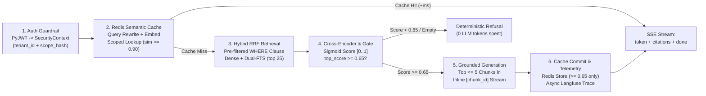

# Enterprise Multi-Tenant RAG Knowledge Engine — Architecture & Phase-by-Phase Deep Dive

Welcome to the complete engineering documentation for the **Enterprise Multi-Tenant RAG Knowledge Engine**. Each guide below teaches what was built in that phase, which exact files were created or changed, why naive implementations fail in production, and how data flows through every line of code.

---

## Reading Order (All 6 Phases)

| Phase | Guide | Core Engineering Focus |
| :---: | :--- | :--- |
| **1** | [Foundation, Pre-Retrieval RBAC & Pluggable Retriever](phase-01-foundation-rbac-retriever.md) | Docker Compose stack, unified Postgres 17 + `pgvector` + dual-dictionary `tsvector` schema, fail-closed JWT `SecurityContext`, metaclass-enforced `VectorStoreRetriever`, single-roundtrip `HYBRID_RRF_SQL` CTE, pluggable Qdrant adapter |
| **2** | [Structure-Aware Ingestion, Token Expansion & Seed Corpus](phase-02-ingestion-embeddings-seed.md) | Header-aware Markdown splitter (preserving tables & fenced code), 7-variant technical token expander (`ERR_*`, `SKU-*`), thread-pooled `BAAI/bge-small-en-v1.5`, idempotent ingestion API, 2-tenant / 3-role seed corpus |
| **3** | [Query Rewriting, Hybrid RRF, Cross-Encoder Reranking & Refusal Gate](phase-03-hybrid-rrf-reranking-refusal-gate.md) | Multi-turn query rewriter with Turn-1 bypass & token preservation, RRF (`rrf_k=60`), `Sigmoid`-calibrated `cross-encoder/ms-marco-MiniLM-L6-v2`, deterministic `< 0.65` Refusal Gate (`llm_called=False`) |
| **4** | [Permission-Scoped Semantic Cache, Grounded Streaming & Telemetry](phase-04-semantic-cache-grounded-sse-telemetry.md) | Redis cache keyed by `tenant_id + scope_hash + entity_fingerprint`, zero-hallucination `<context>` streaming LLM & offline synthesizer, 6-step SSE orchestrator, non-blocking Langfuse v5 tracing |
| **5** | [Ragas Evaluations & Comparative Baseline Benchmark Gates](phase-05-ragas-evals-benchmark-gates.md) | 17 golden answerable cases, 14 adversarial/RBAC traps, Ragas v0.4 two-cohort runner, naive dense-only vs enterprise 6-step benchmark suite & CI gates |
| **6** | [Next.js Chat, Live 6-Step Inspector & Admin Ingestion UI](phase-06-nextjs-chat-inspector-admin-ui.md) | Fetch `ReadableStream` SSE client, Persona & Tenant switcher, split-pane Chat + Telemetry Inspector drawer, inline `[chunk_id]` citation popover, RBAC ingestion modal |

---

## End-to-End 6-Step Request Lifecycle

Every query arriving at `POST /api/v1/chat/stream` executes deterministically across six stages implemented in [`RAGPipelineOrchestrator`](../backend/app/services/rag_pipeline.py):



---

## Measured Enterprise Benchmark Results

Measured in [`evals/reports/latest_benchmark.json`](../evals/reports/latest_benchmark.json) by [`ComparativeBenchmarkRunner`](../backend/app/evals/benchmark_suite.py) across **28 retrieval probes** (17 golden + 11 technical jargon) and **14 adversarial traps**:

- **Retrieval Precision:** **100.0%** (`1.0000` vs `0.8143` naive dense-only baseline — passes `>= 88%` gate)
- **Mean Reciprocal Rank (MRR):** **1.0000** (`+32.59%` lift over `0.7542` baseline — passes `>= +20%` gate)
- **Hallucination Reduction on Adversarial Traps:** **100.0% reduction** (`0.0000` ungrounded rate vs `1.0000` baseline — passes `>= 75%` gate)
- **Cross-Tenant / RBAC Leakage Rate:** **0.0%** (`0.0000` across all privilege escalation and cross-tenant probes)

---

## Quick Local Verification Commands

### Backend (from `backend/`)
```bash
# Run full unit + integration + RBAC + benchmark gate suite
uv run pytest tests -v

# Lint & style check
uv run ruff check app tests

# Seed multi-tenant sample corpus idempotently
uv run python -m app.scripts.seed_corpus
```

### Frontend (from `frontend/`)
```bash
# TypeScript strict check
npx tsc --noEmit

# Production Next.js build
npm run build

# Run local dev server (http://localhost:3005 or default 3000)
npm run dev
```

### Full Container Stack (from repo root)
```bash
docker compose up --build
```
- **Frontend UI:** `http://localhost:3005`
- **Backend API & OpenAPI Docs:** `http://localhost:8000/docs`
- **Health Check:** `http://localhost:8000/api/v1/health`
