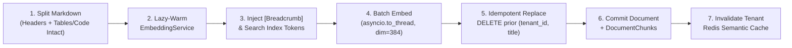

# Phase 2: Structure-Aware Ingestion, Token Expansion, Local Embeddings & Multi-Tenant Seed Corpus

> **Core Problem Solved:** Naive ingestion pipelines slice text blindly every 500 characters—splitting Markdown tables, diagnostic CLI code blocks, and headers right in the middle—and rely on pure semantic vectors that struggle with exact tokens like `ERR_409_CONFLICT` or `SKU-9921-A`. Phase 2 builds a structure-preserving ingestion pipeline, a lexical search-token expander, thread-safe local HuggingFace embeddings, and a realistic 2-tenant / 3-role benchmark corpus.

---

## 1. Commits & File Inventory

| Commit | Scope | Files Added / Modified | Purpose |
| :--- | :--- | :--- | :--- |
| `2018e0e` | Dependency Lock | Modified `.gitignore`, `backend/pyproject.toml`, `backend/uv.lock`, `frontend/package-lock.json` | Locked `langchain-text-splitters`, `sentence-transformers`, `torch`, etc. |
| `c1b721d` | Structure-Aware Splitter | Added `backend/app/services/__init__.py`, `backend/app/services/text_splitter.py`, `backend/tests/unit/test_markdown_splitter.py` | Header-aware Markdown splitter keeping tables & fenced code blocks intact |
| `62bcb8a` | Token Expansion | Added `backend/app/services/token_expansion.py`, `backend/tests/unit/test_token_expansion.py` | Expands exact identifiers (`ERR_*`, `SKU-*`) for PostgreSQL `tsvector` recall |
| `f226ebc` | Local Embeddings | Added `backend/app/services/embeddings.py`, `backend/tests/unit/test_embeddings.py`; modified `backend/app/main.py` | Thread-pooled `BAAI/bge-small-en-v1.5` (384-dim L2-normalized) + FastAPI lifespan warmup |
| `f960374` | Ingestion API & Pipeline | Added `backend/app/schemas/document.py`, `backend/app/services/ingestion.py`, `backend/app/api/v1/documents.py`, `backend/tests/integration/test_ingest_api.py`; modified `backend/app/api/v1/__init__.py`, `backend/tests/conftest.py` | `POST /api/v1/documents/ingest`, `GET /api/v1/documents`, transactional idempotent persistence |
| `da616aa` & `1a48e8c` | Seed Corpus & CLI Loader | Added 8 Markdown runbooks across `seed/acme_corp/` and `seed/globex_corp/`, `seed/refusal_traps/topics_inventory.json`, `backend/app/scripts/__init__.py`, `backend/app/scripts/seed_corpus.py`, `backend/tests/integration/test_seed_corpus.py` | Multi-tenant / tiered-role knowledge base + idempotent SHA-256 CLI seeder |

---

## 2. Structure-Aware Markdown Chunking ([`backend/app/services/text_splitter.py`](../backend/app/services/text_splitter.py))

Instead of fixed character windows that corrupt tabular error matrices or bash command blocks, the splitter preserves document hierarchy in three stages:

1. **Header Hierarchy Split (`MarkdownHeaderTextSplitter`):** Splits on `#`, `##`, `###`, and `####` headers with `strip_headers=False` so heading context stays inside the chunk.
2. **Structural Block Protection (`BLOCK_PATTERN`):** Detects indivisible fenced code blocks (`` ```...``` ``) and Markdown pipe tables (`| ... |`) and keeps them intact inside a single chunk up to `chunk_size=1000`, never chopping a CLI command or error-code row in half.
3. **Contextual Breadcrumb Injection (`_build_breadcrumb`):** Prepends `[Document Title > H1 > H2 > ...]` to the top of every chunk. Even when an individual sub-step chunk is retrieved standalone, both the dense embedder and the LLM know exactly which guide and section it came from.

For example, in [`seed/acme_corp/support_tier_1/storage_troubleshooting_guide.md`](../seed/acme_corp/support_tier_1/storage_troubleshooting_guide.md), the `ERR_409_CONFLICT` CLI recovery commands under `### Step 2: Release Stale Leases & Retry Sync` retain the breadcrumb `[Acme Storage Tier-1 Troubleshooting Guide > Internal Error Code Reference / Resolving ERR_409_CONFLICT Lock Contention > Step 2: Release Stale Leases & Retry Sync]` and keep the entire `acme-storage-cli` fenced block undivided.

---

## 3. Technical Token Expansion ([`backend/app/services/token_expansion.py`](../backend/app/services/token_expansion.py))

PostgreSQL's standard `tsvector` tokenizer splits hyphenated or underscored identifiers in ways that can hurt exact recall depending on whether a user types `ERR_409_CONFLICT`, `err-409-conflict`, or `ERR 409 CONFLICT`.

`token_expansion.py` solves this deterministically:
1. **`TECHNICAL_TOKEN_REGEX`** scans each chunk for structured identifiers (error codes, SKUs, CLI flags, dotted/hyphenated/underscored identifiers).
2. **`expand_technical_tokens(...)`** generates 7 normalized permutations per unique token:
   - Original token (e.g., `ERR_409_CONFLICT`)
   - Hyphen-joined (`ERR-409-CONFLICT`)
   - Underscore-joined (`ERR_409_CONFLICT`)
   - Space-separated (`ERR 409 CONFLICT`)
   - Concatenated (`ERR409CONFLICT`)
   - Lowercase (`err_409_conflict`)
   - Concatenated lowercase (`err409conflict`)
3. **`append_search_index_tokens(...)`** appends `"Search Index Tokens: ..."` as plain text at the bottom of the chunk (specifically avoiding HTML comments like `<!-- ... -->` because PostgreSQL `ts_parse` strips SGML/HTML comments when indexing `tsvector`).
   - *Note (Phase 4 detail):* [`grounded_generator.py`](../backend/app/services/grounded_generator.py) later filters out lines starting with `"Search Index Tokens:"` during offline answer synthesis so users only ever see clean documentation prose!

---

## 4. Non-Blocking Local Embedding Service ([`backend/app/services/embeddings.py`](../backend/app/services/embeddings.py))

`EmbeddingService` wraps `SentenceTransformer("BAAI/bge-small-en-v1.5")` (`384` dimensions, `normalize_embeddings=True`, `batch_size=32`):
- **Pre-Warmed Singleton (`get_embedding_service()`):** Loaded at FastAPI startup inside `main.py`'s `lifespan` via `await asyncio.to_thread(...)` so the first user query pays zero model-download or cold-start penalty.
- **Event Loop Protection:** PyTorch forward passes are CPU/GPU-bound synchronous C++/Python calls. Calling `.encode()` directly inside an `async def` FastAPI route would freeze all concurrent SSE streams. `EmbeddingService` executes inference inside `await asyncio.to_thread(...)` guarded by a loop-aware `asyncio.Semaphore(4)` so concurrency never causes thread/memory thrashing.
- **L2 Normalization:** Normalized unit vectors allow PostgreSQL cosine distance (`<=>`) and Redis cosine dot products to match mathematically with minimal CPU cost.

---

## 5. Transactional Ingestion Pipeline & RBAC Endpoints

### Ingestion Flow ([`backend/app/services/ingestion.py`](../backend/app/services/ingestion.py))
`IngestionService.ingest_document` executes a strict 7-step transactional pipeline:



*(Step 7 cache invalidation was wired cleanly in Phase 4 when [`SemanticCacheService`](../backend/app/services/semantic_cache.py) was introduced.)*

### API Guardrails ([`backend/app/api/v1/documents.py`](../backend/app/api/v1/documents.py) & [`backend/app/schemas/document.py`](../backend/app/schemas/document.py))
- `AUTHORIZED_INGEST_ROLES = {"executive", "support_tier_1", "admin"}`
- **`POST /api/v1/documents/ingest` (`201 Created`):**
  - Rejects `public`-only callers with `403 Forbidden`.
  - Rejects cross-tenant ingestion (`request.tenant_id != ctx.tenant_id`) with `403 Forbidden`.
  - Rejects empty/whitespace content (`422`) via Pydantic validators in `DocumentIngestRequest`.
- **`GET /api/v1/documents` (`200 OK`):** Executes `WHERE Document.tenant_id == ctx.tenant_id` so an admin in `acme_corp` can never list `globex_corp`'s document catalog.

---

## 6. Multi-Tenant Seed Corpus & Adversarial Traps

[`backend/app/scripts/seed_corpus.py`](../backend/app/scripts/seed_corpus.py) populates PostgreSQL idempotently (computing a SHA-256 content digest and skipping unchanged documents) with **8 structured Markdown runbooks** isolated across two companies and three access tiers:

```text
ROLE_TIER_MAPPING:
  public          -> ["public", "support_tier_1", "executive"]
  support_tier_1  -> ["support_tier_1", "executive"]
  executive       -> ["executive"]
```

| Tenant | Role Tier | Document | Key Technical / Privileged Content |
| :--- | :--- | :--- | :--- |
| `acme_corp` | `public` | [`cloud_storage_overview.md`](../seed/acme_corp/public/cloud_storage_overview.md) | Public cloud storage tiers & general onboarding |
| `acme_corp` | `support_tier_1` | [`storage_troubleshooting_guide.md`](../seed/acme_corp/support_tier_1/storage_troubleshooting_guide.md) | `ERR_409_CONFLICT`, `ERR_503_SERVICE_UNAVAILABLE`, `ERR_429_QUOTA_BURST`, `ERR_504_RAFT_QUORUM`, CLI commands |
| `acme_corp` | `support_tier_1` | [`hardware_inventory_skus.md`](../seed/acme_corp/support_tier_1/hardware_inventory_skus.md) | Hardware specifications & thermal limits (`SKU-9921-A`, etc.) |
| `acme_corp` | `executive` | [`q3_financial_expansion_plan.md`](../seed/acme_corp/executive/q3_financial_expansion_plan.md) | Confidential Q3 budgets, M&A targets, revenue forecasts |
| `globex_corp` | `public` | [`cybersecurity_suite_intro.md`](../seed/globex_corp/public/cybersecurity_suite_intro.md) | Public Globex cybersecurity product overview |
| `globex_corp` | `support_tier_1` | [`firewall_error_codes.md`](../seed/globex_corp/support_tier_1/firewall_error_codes.md) | Globex internal firewall error codes & diagnostics |
| `globex_corp` | `support_tier_1` | [`appliance_skus.md`](../seed/globex_corp/support_tier_1/appliance_skus.md) | Globex hardware appliance SKUs |
| `globex_corp` | `executive` | [`acquisition_targets_q4.md`](../seed/globex_corp/executive/acquisition_targets_q4.md) | Confidential Globex Q4 M&A targets |

Additionally, [`seed/refusal_traps/topics_inventory.json`](../seed/refusal_traps/topics_inventory.json) defines 8 adversarial refusal trap templates spanning `out_of_domain`, `unanswerable_internal_gap`, `rbac_privilege_escalation`, and `cross_tenant_isolation`.

---

## 7. How Phase 2 Was Verified
- [`backend/tests/unit/test_markdown_splitter.py`](../backend/tests/unit/test_markdown_splitter.py): Verified code fences and Markdown tables are never severed mid-block and `[Title > Section]` breadcrumbs are prepended.
- [`backend/tests/unit/test_token_expansion.py`](../backend/tests/unit/test_token_expansion.py): Verified 7-variant expansion and plain-text `"Search Index Tokens:"` generation.
- [`backend/tests/unit/test_embeddings.py`](../backend/tests/unit/test_embeddings.py): Verified 384-dim L2-normalized outputs and thread-pool/semaphore execution.
- [`backend/tests/integration/test_ingest_api.py`](../backend/tests/integration/test_ingest_api.py): Verified `201` ingestion, `403` cross-tenant & low-role blocks, `422` validation, and re-ingestion idempotency.
- [`backend/tests/integration/test_seed_corpus.py`](../backend/tests/integration/test_seed_corpus.py): Verified full 8-document multi-tenant seeding and SHA-256 skip idempotency.
