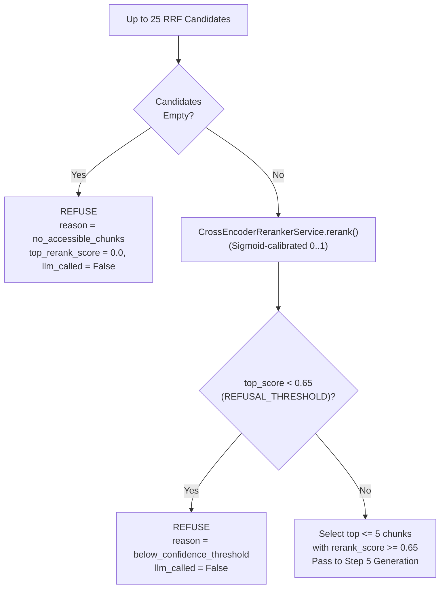

# Phase 3: Query Rewriting, Hybrid RRF Retrieval, Cross-Encoder Reranking & Deterministic Refusal Gate

> **Core Problem Solved:** Bi-encoder vector search casts a fast approximate net, but mixes relevant hits with false positives—and an unrestricted LLM will happily invent answers when retrieved context only weakly overlaps the question. Phase 3 implements conversational query rewriting, executes the pre-filtered 25-candidate hybrid RRF funnel, rescores every candidate deeply with a Cross-Encoder, and short-circuits deterministically below `0.65` confidence.

---

## 1. Commits & File Inventory

| Commit | Scope | Files Added / Modified | Purpose |
| :--- | :--- | :--- | :--- |
| `0ab5387` | Query Rewriting & SQL Guard | Added `backend/app/schemas/retrieval.py`, `backend/app/services/query_rewriter.py`, `backend/tests/unit/test_query_rewriter.py`; modified `backend/app/config.py`, `backend/app/retrievers/postgres_hybrid.py` | Multi-turn query rewriter with Turn-1 bypass & verbatim technical token preservation |
| `0448db7` | Hybrid Funnel Orchestration | Added `backend/app/services/hybrid_retrieval.py`, `backend/tests/integration/test_hybrid_retrieval_pipeline.py` | Coordinates rewrite -> query embed -> `VectorStoreRetriever.retrieve_hybrid` |
| `5a460a1` | Cross-Encoder Reranker | Added `backend/app/services/reranker.py`, `backend/tests/unit/test_reranker.py`; modified `backend/app/main.py`, `backend/tests/integration/test_ingest_api.py` | Local `cross-encoder/ms-marco-MiniLM-L6-v2` with `Sigmoid()` calibration + lifespan warmup |
| `8ef7d37` | Refusal Gate | Added `backend/app/services/refusal_gate.py`, `backend/tests/unit/test_refusal_gate.py`; modified `backend/app/schemas/retrieval.py` | Deterministic `score < 0.65` refusal gate (`RefusalGateDecision`) |

---

## 2. Multi-Turn Query Rewriting ([`backend/app/services/query_rewriter.py`](../backend/app/services/query_rewriter.py))

Users rarely repeat every noun or error code in follow-up messages (e.g., Turn 1: *"What causes ERR_409_CONFLICT?"*, Turn 2: *"How do I release its stale lease?"*). Passing *"How do I release its stale lease?"* directly to search degrades recall.

### Execution Logic in `QueryRewriterService.rewrite(...)`
1. **Extract Preserved Technical Tokens (`extract_technical_tokens`):** Before any LLM call, regex extractors (`_CLI_FLAG_REGEX` + `TECHNICAL_TOKEN_REGEX`) pull all CLI flags (`--max-inflight-writes`), error codes (`ERR_409_CONFLICT`), and SKUs (`SKU-9921-A`) in first-seen order.
2. **Turn-1 Fast Path (`was_rewritten=False`):** If `chat_history` has no prior `user` turns, rewriting is skipped in `< 1ms` to save an external LLM roundtrip.
3. **LLM Rewrite with Offline Fallback:**
   - When an OpenAI/Gemini/Anthropic key matches `self.model`, calls `litellm.acompletion(temperature=0.0, max_tokens=200)` with the last `max_history_turns=6` messages and a strict prompt treating chat history as untrusted data.
   - If no API key is configured (e.g., offline CI/tests) or the provider fails, `_deterministic_rewrite` merges the previous user turn cleanly as `"{query} (context: {last_user_topic})"`.
4. **Hard Token Preservation Guardrail (`_enforce_token_preservation`):** Even if an LLM rewrites *"ERR_409_CONFLICT"* into *"a conflict error"*, the post-processor checks case-insensitively and appends any dropped technical identifiers verbatim so exact lexical search never loses critical tokens.

---

## 3. Hybrid RRF Retrieval Service ([`backend/app/services/hybrid_retrieval.py`](../backend/app/services/hybrid_retrieval.py))

`HybridRetrievalService.retrieve_candidates(...)` stitches rewriting, dense query embedding, and database search into a reusable service returning [`HybridRetrievalResult`](../backend/app/schemas/retrieval.py):

1. Reuses precomputed `rewrite_result` and/or `query_embedding` if already computed earlier in the request (for example, during Phase 4's Step 2 semantic cache lookup—preventing duplicate LLM rewrites or redundant PyTorch forward passes!).
2. Lazy-warms `EmbeddingService` if not yet warmed in test environments, then encodes the `rewritten_query` on a worker thread.
3. Invokes `self.retriever.retrieve_hybrid(security_ctx, query_text=..., query_embedding=..., top_k=25)`.
4. Returns `candidates` ordered by descending `rrf_score` alongside exact `embedding_latency_ms` and `retrieval_latency_ms` telemetry.

### Why Reciprocal Rank Fusion (`rrf_k = 60`)?
Cosine similarity scores (`0.0–1.0`) and PostgreSQL `ts_rank_cd` lexical scores are on incompatible numerical scales. RRF fuses them cleanly using only rank positions inside `postgres_hybrid.py`:

$$\text{RRF}(d) = \frac{1}{60 + \text{rank}_{\text{dense}}(d)} + \frac{1}{60 + \text{rank}_{\text{sparse}}(d)}$$

Chunks appearing high in **both** semantic meaning and exact keyword match naturally rise to the top of the 25-chunk funnel.

---

## 4. Calibrated Cross-Encoder Reranking ([`backend/app/services/reranker.py`](../backend/app/services/reranker.py))

Bi-encoders encode query and chunk separately (fast, suitable for searching thousands/millions of vectors, but misses fine token-to-token interactions). A **Cross-Encoder** feeds `(query, chunk.content)` *jointly* through full self-attention.

### Crucial Engineering Details in `CrossEncoderRerankerService`
- **Model & Sigmoid Calibration:** Uses `cross-encoder/ms-marco-MiniLM-L6-v2` (overridable via `RERANKER_MODEL`) initialized with **`activation_fn=torch.nn.Sigmoid()`**.
  - *Why this matters:* Raw MS-MARCO Cross-Encoder outputs are unbounded logits (e.g., `-8.4` to `+9.2`), making a fixed threshold like `0.65` meaningless without calibration. Passing logits through Sigmoid maps every score onto a clean `[0.0, 1.0]` probability-like confidence scale.
- **Safety Clamping & NaN Guard:** Scores are sanitized against `NaN`/`inf` and clamped to `[0.0, 1.0]`.
- **Non-Blocking Thread Execution:** Protected by a loop-aware `asyncio.Semaphore(4)` and `await asyncio.to_thread(...)`, pre-warmed at FastAPI startup alongside `EmbeddingService`.
- **Scoring & Selection:** Evaluates up to 25 candidates and returns them sorted descending by `rerank_score` plus exact `rerank_latency_ms`.

---

## 5. Deterministic "No Answer" Refusal Gate ([`backend/app/services/refusal_gate.py`](../backend/app/services/refusal_gate.py))

This component is the primary defense against enterprise AI hallucination:

### Exact Gate Behavior (`RefusalGateService.evaluate`)
1. If zero candidates passed the RBAC `WHERE` filter (e.g., a `public` user asks about an `executive`-only topic), it immediately returns `should_refuse=True`, `refusal_reason="no_accessible_chunks"`, `llm_called=False`—never leaking whether a restricted document even exists.
2. Otherwise, it runs the Cross-Encoder over the candidate pool.
3. If `reranked[0].rerank_score < self.threshold` (`0.65` default from `REFUSAL_THRESHOLD`), it returns:
   - `should_refuse = True`
   - `refusal_reason = "below_confidence_threshold"`
   - `refusal_message = "I don't have enough verified information in your accessible knowledge base to answer this."` (`VERIFIED_REFUSAL_MESSAGE`)
   - `llm_called = False`
   - `selected_chunks = []` (while preserving `all_reranked_chunks` so the Live Telemetry Inspector can display *why* it refused!).
4. If confidence passes (`>= 0.65`), only chunks meeting the threshold (up to `max_context_chunks = 5`) advance to Step 5 Grounded Generation.

---

## 6. How Phase 3 Was Verified
- [`backend/tests/unit/test_query_rewriter.py`](../backend/tests/unit/test_query_rewriter.py): Verified Turn-1 zero-LLM fast path, multi-turn history resolution, and 100% verbatim preservation of `ERR_*`, `SKU-*`, and `--*` CLI flags.
- [`backend/tests/integration/test_hybrid_retrieval_pipeline.py`](../backend/tests/integration/test_hybrid_retrieval_pipeline.py): Verified pre-filtered hybrid RRF recall on exact technical codes and conversational queries against PostgreSQL.
- [`backend/tests/unit/test_reranker.py`](../backend/tests/unit/test_reranker.py): Verified Sigmoid `[0, 1]` normalization, relevant-above-irrelevant ordering, and async non-blocking execution.
- [`backend/tests/unit/test_refusal_gate.py`](../backend/tests/unit/test_refusal_gate.py): Verified both deterministic refusal paths (`no_accessible_chunks` and `below_confidence_threshold`), `llm_called=False`, and `VERIFIED_REFUSAL_MESSAGE` output.
