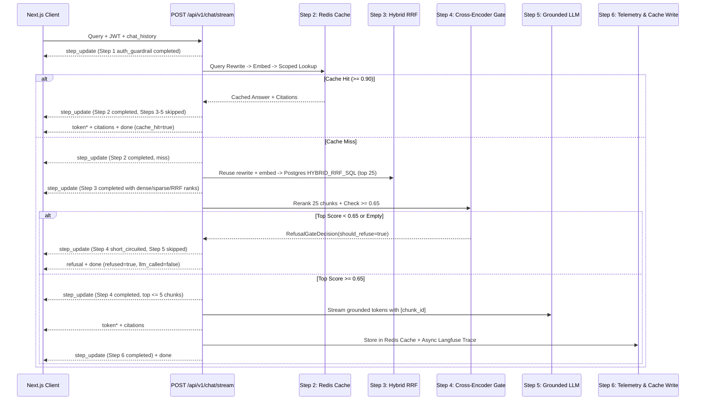

# Phase 4: Permission-Scoped Semantic Cache, Grounded Streaming, 6-Step Orchestrator & Langfuse Telemetry

> **Core Problem Solved:** Even with high retrieval accuracy, calling an LLM on repeated semantically similar questions wastes money and adds seconds of latency—yet a naive vector cache leaks privileged answers across tenants or roles, and a non-grounded prompt still risks hallucinations or missing citations. Phase 4 ties all 6 request lifecycle stages together with a permission-and-entity-scoped Redis cache, strict `<context>` grounded streaming, and non-blocking telemetry.

---

## 1. Commits & File Inventory

| Commit | Scope | Files Added / Modified | Purpose |
| :--- | :--- | :--- | :--- |
| `de6adf5` | Semantic Cache | Added `backend/app/schemas/cache.py`, `backend/app/services/semantic_cache.py`, `backend/tests/integration/test_semantic_cache.py`; modified `backend/app/services/ingestion.py` | Redis key-partitioned semantic cache (`tenant_id + scope_hash + entity_fingerprint`) + cache invalidation on document ingest |
| `4f27950` & `bc2ed98` | Grounded Generator & Telemetry | Added `backend/app/schemas/chat.py`, `backend/app/services/grounded_generator.py`, `backend/app/services/telemetry.py`, `backend/tests/unit/test_grounded_generator.py`; modified `backend/app/services/refusal_gate.py` | Zero-hallucination `[chunk_id]` streaming LLM + offline extractive synthesizer + non-blocking Langfuse v5 trace emitter + `"Search Index Tokens:"` filter |
| `68dc551` | 6-Step SSE Pipeline & Chat API | Added `backend/app/services/rag_pipeline.py`, `backend/app/api/v1/chat.py`, `backend/tests/integration/test_chat_stream_sse.py`; modified `backend/app/api/v1/__init__.py`, `backend/app/services/hybrid_retrieval.py` | End-to-end 6-step SSE orchestrator, `POST /api/v1/chat/stream`, `GET /api/v1/chat/traces/{trace_id}`, precomputed rewrite/embedding reuse |

---

## 2. Permission-Scoped Redis Semantic Cache ([`backend/app/services/semantic_cache.py`](../backend/app/services/semantic_cache.py))

Why isn't cosine similarity alone safe for caching? Consider two failure modes solved in `SemanticCacheService`:
1. **Cross-Role/Tenant Leakage:** If an `executive` asks *"What are Q3 M&A targets?"* and a `public` user asks the exact same question 5 seconds later, an unscoped semantic cache would serve confidential executive M&A data to a public user!
2. **Error-Code Collision (`ERR_409_CONFLICT` vs `ERR_503_SERVICE_UNAVAILABLE`):** Two queries *"How do I fix ERR_409_CONFLICT?"* and *"How do I fix ERR_503_SERVICE_UNAVAILABLE?"* can have `> 0.92` sentence embedding cosine similarity, causing catastrophic wrong-remediation cache hits!

### How `SemanticCacheService` Solves Both
1. **Strict Namespace Partitioning in Key Design:**
   ```text
   llm_cache:{tenant_id}:{scope_hash}:{entity_fingerprint}:{entry_id}
   ```
   - `tenant_id` and `scope_hash` come strictly from the verified JWT `SecurityContext`.
   - `compute_entity_fingerprint(query)` extracts `ERR_*`, `SKU-*`, and `--*` CLI flags, normalizes to lowercase with `_`, sorts alphabetically, and joins with `|` (or `"none"` if no exact identifiers exist). So `ERR_409_CONFLICT` and `ERR_503_SERVICE_UNAVAILABLE` live in **disjoint cache partitions** and can never collide.
2. **Lookup (`SCAN` + `MGET` + Defense-in-Depth + Cosine `>= 0.90`):**
   - Scans only the caller's `llm_cache:{tenant_id}:{scope_hash}:{entity_fingerprint}:*` prefix.
   - Fetches candidate JSON payloads via batch `MGET`.
   - Applies a secondary defense-in-depth check verifying `entry.tenant_id == ctx.tenant_id`, `entry.scope_hash == ctx.scope_hash`, and `entry.entity_fingerprint == entity_fingerprint`.
   - Computes L2-normalized dot product cosine similarity and triggers a hit when `score >= 0.90` (`similarity_threshold`).
3. **Cache Poisoning Prevention on `store()`:** Refuses to cache any response whose `top_rerank_score < REFUSAL_THRESHOLD` (`0.65`), and [`IngestionService`](../backend/app/services/ingestion.py) calls `SemanticCacheService.invalidate_tenant(tenant_id)` whenever documents are uploaded or updated so stale answers never persist.

---

## 3. Grounded Generation & Offline Extractive Synthesizer ([`backend/app/services/grounded_generator.py`](../backend/app/services/grounded_generator.py))

Once Step 4 approves chunks (`top_rerank_score >= 0.65`), Step 5 formats every approved chunk using `format_context_block(chunk)`:
```text
[<chunk_id>] (<document_title> - <section_header>):
<chunk.content>
```
1. **Live Cloud LLM or Local Ollama Mode (`litellm.acompletion`, `temperature=0.0`, `stream=True`):**
   - Uses `build_system_prompt()` wrapping chunks inside `<context>` delimiters with explicit instructions to answer **only** from `<context>`, treat retrieved text strictly as untrusted data, cite exact `[chunk_id]` tags on every factual claim, and refuse with `VERIFIED_REFUSAL_MESSAGE` if evidence is insufficient.
   - Resolved via [`llm_provider.py`](../backend/app/services/llm_provider.py): selects `OPENAI_API_KEY` / `GEMINI_API_KEY` / `ANTHROPIC_API_KEY` for cloud models, or passes `api_base=OLLAMA_API_BASE` (`http://localhost:11434` by default) for `ollama/*` and `ollama_chat/*` models (`stream_mode="ollama_local"` vs `"cloud_llm"`), including LiteLLM's Ollama async trailing-`None` `TypeError` guard.
2. **Deterministic Offline Extractive Mode (`synthesize_offline_answer`):**
   - When no external API key is configured (e.g., local demos without paid keys, CI benchmarks, or automated tests), `GroundedGeneratorService` deterministically extracts and ranks the highest-relevance sentences, markdown table rows, and CLI fenced code blocks from the approved chunks, filters out `"Search Index Tokens:"` metadata lines, attaches `[chunk_id]` inline citations to every statement, and streams the answer token-by-token (`stream_mode="offline_deterministic"`).

---

## 4. The Complete 6-Step Orchestrator ([`backend/app/services/rag_pipeline.py`](../backend/app/services/rag_pipeline.py))

`RAGPipelineOrchestrator.stream_lifecycle` executes all 6 stages for [`POST /api/v1/chat/stream`](../backend/app/api/v1/chat.py) and emits Server-Sent Events (`event: <name>\ndata: <json>\n\n`):



### SSE Event Contract
| Event Name | Payload Purpose |
| :--- | :--- |
| `step_update` | Live [`PipelineStepTelemetry`](../backend/app/schemas/chat.py) (`step: 1..6`, `name`, `label`, `status`, `latency_ms`, `details`) |
| `token` | Incremental answer text delta (`{"delta": "..."}`) |
| `citations` | Grounded chunk list (`chunk_id`, `document_title`, `section_header`, `content`, `allowed_roles`, `rerank_score`) |
| `refusal` | Emitted only on deterministic refusal (`reason`, `message`, `top_score`, `threshold`) |
| `done` | Final execution envelope (`trace_id`, `total_latency_ms`, `cache_hit`, `refused`, `llm_called`) |

---

## 5. Non-Blocking Telemetry & Trace Inspection ([`backend/app/services/telemetry.py`](../backend/app/services/telemetry.py))

1. **In-Memory Bounded Ring Buffer (`deque(maxlen=200)`):** [`TelemetryService.record_trace`](../backend/app/services/telemetry.py) records a [`PipelineTraceRecord`](../backend/app/schemas/chat.py) synchronously right before emitting the final `done` frame so immediate follow-up `GET /api/v1/chat/traces/{trace_id}` requests never race.
2. **Tenant-Isolated Trace Endpoint ([`backend/app/api/v1/chat.py`](../backend/app/api/v1/chat.py)):** `GET /api/v1/chat/traces/{trace_id}` verifies `trace.tenant_id == security_ctx.tenant_id`, returning `403 Forbidden` if another tenant requests a valid trace ID and `404 Not Found` if absent.
3. **Fire-and-Forget Langfuse v5 Export:** When `LANGFUSE_PUBLIC_KEY` and `LANGFUSE_SECRET_KEY` are present, Telemetry schedules `_emit_langfuse_sync` via `asyncio.create_task(asyncio.to_thread(...))`—constructing a root Langfuse `chain` trace plus 6 typed child observations (`guardrail`, `span`, `retriever`, `rerank`, `generation`, `span`) without blocking the client SSE stream by a single millisecond.

---

## 6. How Phase 4 Was Verified
- [`backend/tests/integration/test_semantic_cache.py`](../backend/tests/integration/test_semantic_cache.py): Verified tenant isolation, role `scope_hash` isolation, `ERR_409_CONFLICT` vs `ERR_503_SERVICE_UNAVAILABLE` fingerprint disjointness, cosine `>= 0.90` hits, refusal-score store blocking, and cache invalidation on ingest.
- [`backend/tests/unit/test_grounded_generator.py`](../backend/tests/unit/test_grounded_generator.py): Verified `<context>` prompt boundaries, inline `[chunk_id]` citation enforcement, and `"Search Index Tokens:"` stripping.
- [`backend/tests/integration/test_chat_stream_sse.py`](../backend/tests/integration/test_chat_stream_sse.py): Verified all 3 SSE lifecycles end-to-end (miss -> generate -> cache write; subsequent semantic cache hit skipping Steps 3–5; `< 0.65` refusal skipping Step 5 with `llm_called=false`), `bypass_cache=true`, and cross-tenant `403` protection on `/traces/{trace_id}`.
