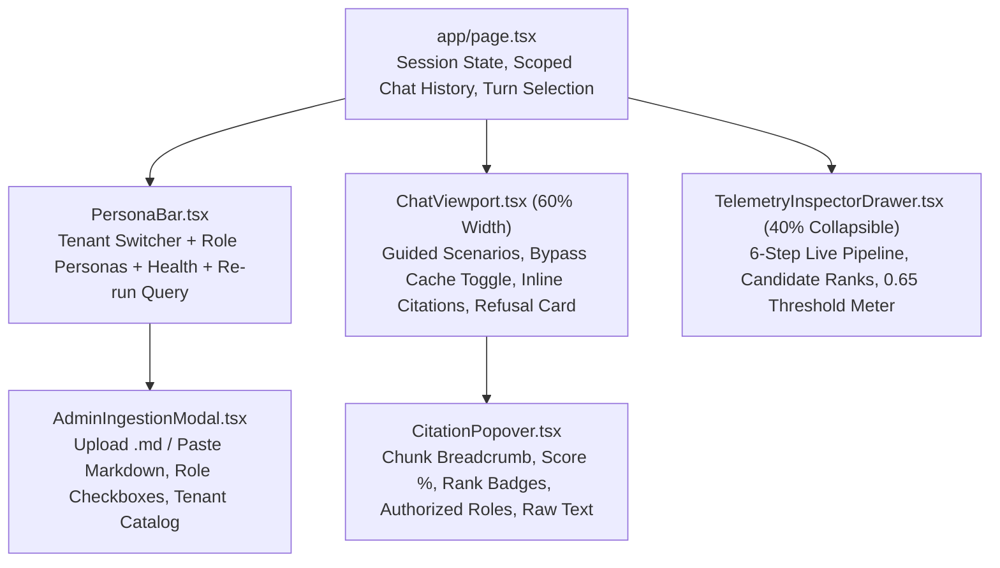

# Phase 6: Interactive Next.js Chat, Live 6-Step Telemetry Inspector & Admin Ingestion UI

> **Core Problem Solved:** An enterprise RAG engine with pre-retrieval RBAC, semantic caching, hybrid RRF rankings, and a `< 0.65` refusal gate is hard to trust or demonstrate if those internals remain hidden in server logs. Phase 6 builds a split-pane Next.js App Router workspace where every answer is transparent: users can switch tenants/personas live, inspect exact dense vs BM25 vs Cross-Encoder scores in real time, click inline `[chunk_id]` citations, and upload RBAC-tagged Markdown docs.

---

## 1. Commits & File Inventory

| Commit | Scope | Files Added / Modified | Purpose |
| :--- | :--- | :--- | :--- |
| `4810b10` | Types, SSE Client & Persona Bar | Added `frontend/src/types/rag.ts`, `frontend/src/lib/sse-client.ts`, `frontend/src/components/PersonaBar.tsx` | Full TypeScript event/trace interfaces, Fetch `ReadableStream` SSE parser (supporting `Authorization` headers), live JWT switcher |
| `4c2ee52` | Chat Viewport & Citation Popover | Added `frontend/src/components/ChatViewport.tsx`, `frontend/src/components/CitationPopover.tsx`; modified `frontend/tsconfig.json` | 4 guided enterprise scenarios, inline clickable `[chunk_id]` pills, Cross-Encoder & RRF rank inspection modal |
| `00e16b0` | Build Hygiene | Modified `.gitignore` | Ignored Next.js generated `next-env.d.ts` and `*.tsbuildinfo` |
| `79febb2` | Telemetry Inspector Drawer | Added `frontend/src/components/TelemetryInspectorDrawer.tsx` | Live 6-step pipeline accordion (RBAC proof, Redis cache similarity, candidate RRF/rerank table, `0.65` threshold bar, trace JSON/Langfuse details) |
| `0825d16` | Admin Ingestion Modal & Workspace | Added `frontend/src/components/AdminIngestionModal.tsx`; rewrote `frontend/src/app/page.tsx` | 60%/40% split-pane workbench, RBAC document upload modal, backend trace hydrate & multi-turn history scoping |

---

## 2. Custom `fetch` SSE Client & Citation Parsing ([`frontend/src/lib/sse-client.ts`](../frontend/src/lib/sse-client.ts))

Browser `EventSource` cannot send custom `Authorization: Bearer <token>` headers or `POST` JSON bodies. Therefore, `sse-client.ts` implements a clean Fetch + `TextDecoder` SSE frame parser:

1. **`streamChatQuery(token, request, callbacks, signal)`:**
   - Sends `POST /api/v1/chat/stream` with `Authorization: Bearer <token>`, `chat_history` (up to last 6 turns scoped to the active tenant/persona), `bypass_cache`, and an `AbortSignal` so users can click **Stop** mid-stream.
   - Buffers incoming UTF-8 chunks, splits on `\n\n` frame boundaries (normalizing `\r\n`), and dispatches typed callbacks (`onStepUpdate`, `onToken`, `onCitations`, `onRefusal`, `onDone`, `onError`).
2. **Inline Citation Tokenization (`parseTextWithCitations`):**
   - Scans assistant prose for `/\[([a-f0-9-]{6,36})\]/gi` and splits text safely into `{ type: "text" | "citation" }` React segments—avoiding `dangerouslySetInnerHTML` entirely (zero XSS risk).
3. **Telemetry Enrichment (`mergeCitationsWithCandidateTelemetry`):**
   - Joins final `citations` payloads with Step 3/Step 4 candidate telemetry rows so clicking an inline citation displays its exact `dense_rank`, `sparse_rank`, `rrf_score`, and `rerank_score`.

---

## 3. Component Architecture

### Component Breakdown
1. **Top Persona & Tenant Bar ([`PersonaBar.tsx`](../frontend/src/components/PersonaBar.tsx)):**
   - Instant selector between `acme_corp` and `globex_corp`, and personas `public`, `support_tier_1`, and `executive`.
   - Calls `POST /api/v1/auth/demo-token` immediately, updates the active JWT + `scope_hash`, and offers a one-click **"Re-run Last Query"** button so you can ask about executive data as `public` (see immediate refusal), switch to `executive`, and re-run to watch authorized retrieval succeed!
2. **Split-Pane Workspace ([`page.tsx`](../frontend/src/app/page.tsx)):**
   - **Tenant/Persona Isolation in Frontend History:** When computing `chat_history` for multi-turn query rewriting, `page.tsx` filters `turns` strictly to the current `tenant_id` and `persona` so conversational context from an `executive` turn never leaks into a subsequent `public` query rewrite.
   - **60% Chat / 40% Collapsible Telemetry Inspector** responsive layout.
3. **Interactive Chat Viewport ([`ChatViewport.tsx`](../frontend/src/components/ChatViewport.tsx)):**
   - Includes **4 one-click `GUIDED_SCENARIOS`**:
     1. *Exact Error Code (`ERR_409_CONFLICT`, Support Tier 1)* -> tests BM25 + RRF hybrid precision
     2. *Hardware SKU Lookup (`SKU-9921-A`, Support Tier 1)* -> tests hyphenated SKU expansion
     3. *Executive M&A Strategy (Executive Only)* -> demonstrates RBAC boundary
     4. *Out-of-Domain Refusal Trap (Public)* -> demonstrates `< 0.65` Refusal Gate with 0 LLM tokens spent
   - Toggleable **`bypass_cache`** checkbox so users can force a fresh cache miss and observe Steps 3–6 execute even after a query has already been cached.
   - Distinct amber/red **Refusal Card** when Step 4 short-circuits (`top_score` vs `0.65` threshold), and clickable `[chunk_id]` citation chips opening [`CitationPopover.tsx`](../frontend/src/components/CitationPopover.tsx).
4. **Live 6-Step Telemetry Inspector ([`TelemetryInspectorDrawer.tsx`](../frontend/src/components/TelemetryInspectorDrawer.tsx)):**
   - Displays all 6 lifecycle stages (`auth_guardrail`, `semantic_cache`, `hybrid_retrieval`, `rerank_gate`, `grounded_generation`, `telemetry_commit`) updating live (`pending` -> `running` -> `completed` / `short_circuited` / `skipped`) with millisecond latency pills and stage-specific deep diagnostics.
5. **Admin Document Ingestion Modal ([`AdminIngestionModal.tsx`](../frontend/src/components/AdminIngestionModal.tsx)):**
   - Lists the active tenant's indexed documents (`GET /api/v1/documents`).
   - Supports `.md`/`.txt` file upload or pasting raw Markdown with role checkboxes (`public`, `support_tier_1`, `executive`).
   - Demonstrates backend RBAC enforcement directly in the UI: attempting ingestion while logged in as a `public` persona surfaces the server's `403 Forbidden` RBAC alert cleanly.

---

## 4. How Phase 6 Was Verified
- **TypeScript Strict Check:** `npm --prefix frontend run tsc -- --noEmit` -> `0` errors.
- **Production Build:** `npm --prefix frontend run build` -> Next.js production bundle & static pages (`/` and `/_not-found`) compiled cleanly with exit code `0`.
- **XSS / DOM Safety Audit:** Verified `0` usages of `dangerouslySetInnerHTML`, `innerHTML`, or unsafe eval across `frontend/src/`.
